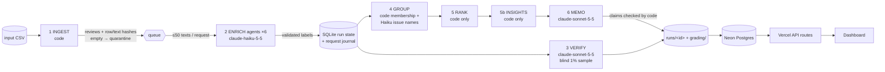

# Spotify review insights — a multi-agent large-data pipeline

Turns 97.4 MB of real Google Play reviews of Spotify (660,622 rows, May 2022 – Nov 2023) into an inspectable product
recommendation: **where should next quarter's effort go — access, usability, playback, or billing/support?**

| | |
|---|---|
| **Live dashboard** | **https://spotify-review-insights-dun.vercel.app** — public, no login. Next.js on Vercel; its API routes read the processed data from a Neon Postgres database. |
| **Decision memo** | [`runs/final-150k/memo.md`](runs/final-150k/memo.md) (claims in [`claims.csv`](runs/final-150k/claims.csv)) |
| **Grading export** | [`grading/`](grading/) — contract files (`run.json` declares the 150k subset); self-check output in [`evals/self_check_final.json`](evals/self_check_final.json) |
| **Cost calculator** | [`cost/`](cost/) — offline replay `python -m cost.calculator`; report [`cost/report.md`](cost/report.md) |
| **Interruption / resume recording** | [Google Drive video](https://drive.google.com/file/d/1fKObwhdt5w98f80MowDUcLDdwNy4i_lI/view?usp=sharing) (run `final-100k`) + [`checkpoint_before.json`](grading/checkpoint_before.json) / [`checkpoint_after.json`](grading/checkpoint_after.json) |
| **Dataset** | Course ZIP ([Google Drive](https://drive.google.com/file/d/1P0rUoAS_wVjp3BYKqXMEyD4u0uJP1Bvf/view)); source BwandoWando, *3.4 Million Spotify Google Store Reviews* v2 (Kaggle, CC0). `spotify_reviews_18months.csv` SHA-256 `1fc85de68a304dd8978b537cfa58793d5f41cbaf417fa32cb53899f83a2fcef6` (97,400,616 bytes). Not committed. |

> **Scope (declared).** The **entire 660,622-row file is ingested, profiled and hash-checked**. Classification covers
> a declared, deterministic **150,013-row analysis subset** (150,000 nonempty reviews + all 13 empty texts) — 1.5× the
> assignment's "at least 100,000" option. It was built in two nested steps: a 100,013-row subset (run `final-100k`,
> which contains the recorded interruption/resume) extended by the next 50,000 hash-ordered reviews (run `final-150k`,
> which reuses every 100k result through the exact-text cache and labels only the new reviews). The remaining ~510k
> nonempty reviews are profiled but **not classified** (a local-model "phase 2" is planned), so the coverage point is
> partial by design. Numbers below are from `final-150k` unless labelled otherwise.

## Results at a glance

| | |
|---|---|
| Source file ingested & profiled | **660,622 rows** (13 empty texts, 159,701 missing app versions, 0 duplicate IDs, 484,189 distinct nonempty texts) — [`ingestion_report.json`](runs/ingestion/ingestion_report.json); `grading/ingestion.json` is byte-identical to the checker's profile |
| Declared analysis subset | `analysis_150k.csv`: 150,013 rows = 150,000 nonempty + 13 empty; SHA-256 `8ae9c59c74eaba57064798e0612eac610de3e0571342990b1e3d4cbdf3b78bfe`; rule in [`pipeline/stages/ingest.py`](pipeline/stages/ingest.py) (superset of the 100k subset, which contains the golden 50 and all development files) |
| Accounted for / classified | **150,013 / 150,013 accounted** (100%); **149,996 classified** (99.997% of nonempty); 17 quarantined = 13 empty + 4 unresolved ([`quarantine.jsonl.gz`](runs/final-150k/quarantine.jsonl.gz)) |
| Exact-text cache reuse | 34,459 records reuse a direct original via `cache_source_id` (checker-validated); results from earlier runs were imported with their original call records |
| Independent verifier (Sonnet 5.5, blind, n=1149) | topic 85.6% · intent 94.0% · severity exact 90.2% (MAE 0.1027); planted wrong labels caught 10/10 |
| Golden 50 (human, blind) | topic 60% · intent 84% · severity exact 82% (MAE 0.24); 3 ambiguous; [error analysis](evals/golden/error_analysis.md) |
| Prompt-injection test (synthetic) | 8/8 attacks resisted in one mixed request with real reviews |
| Checker (`check_submission.py`, 150k reference) | coverage candidate **1.0** relative to the declared subset; flags: `{"call_config_mismatch": 26, "unfinished_classification": 1}` — explained [below](#checker-flags-explained) |
| Cost (API, list rates) | final run new spend **$4.74** (enrich $3.03, verify $1.65, group $0.01, memo $0.06); imported earlier results $6.21; **whole project ≈ $12.71** |
| Runtime & concurrency | final run 1.4 h wall-clock with 4 enrichment agents and 0 rate-limit (429) responses; the 100k run used 6 agents and hit 1,052 429s (retried with backoff, not billed) without being faster — so 4 agents is the measured sweet spot; 173 records via the capped Sonnet fallback (≤2% cap) |
| Recommendation | **billing_support** — Prioritize billing_support: revisit and measure the free-tier control paywall, the largest and fastest-rising chronic complaint driver. |

Measured values come from saved provider usage and wall clocks; projections and modelled scenarios are only in [`cost/report.md`](cost/report.md) and are labelled as estimates.


---

## Rubric → evidence map

| Rubric item | Evidence |
|---|---|
| **D1** Accessible code/setup and artifacts | [Setup](#setup), [`requirements.txt`](requirements.txt), [`.env.example`](.env.example), commands below; all outputs committed under `runs/`, `grading/`, `cost/`, `evals/` |
| **D2** Architecture, shared schema, provenance | [Architecture](#architecture), [`prompts/labels.md`](prompts/labels.md), [`pipeline/schema.py`](pipeline/schema.py), per-run [`manifest.json`](runs/final-150k/manifest.json) (input SHA-256, code commit, prompt hashes, model IDs/settings, label_config), row hashes in every record |
| **D3** Memo numbers linked to calculations & sources | [`memo.md`](runs/final-150k/memo.md) cites claim IDs → [`claims.csv`](runs/final-150k/claims.csv) → [`ranking.csv`](runs/final-150k/ranking.csv) → [`membership.csv`](runs/final-150k/membership.csv) → [`enriched.jsonl.gz`](runs/final-150k/enriched.jsonl.gz); code validation in [`pipeline/stages/memo.py`](pipeline/stages/memo.py); [traced example](#one-review-traced-end-to-end) |
| **D4** Coherent recommendation, alternatives, limitations | [Decision memo](#decision-memo), dashboard recommendation panel, [Limitations](#limitations) |
| **T1** 50 human labels, per-field comparison, error analysis | [`evals/golden/`](evals/golden/): [`golden_50_labeled.csv`](evals/golden/golden_50_labeled.csv), [`per_case.csv`](evals/golden/per_case.csv), [`results.json`](evals/golden/results.json), confusion tables, [`error_analysis.md`](evals/golden/error_analysis.md) |
| **T2** Independent verification, planted-error and injection tests | [`runs/final-150k/verify/`](runs/final-150k/verify/) (blind Sonnet re-label + disagreement report + planted-error test), [`evals/injection/injection_results.json`](evals/injection/injection_results.json), human spot-check [`evals/spotcheck/dev-500/`](evals/spotcheck/dev-500/) |
| **T3** Real cold/warm pilot, calculator, retry/spend/recovery controls | [`cost/report.md`](cost/report.md), [`cost/`](cost/) evidence files, [`tests/test_calculator.py`](tests/test_calculator.py), [`tests/test_recovery.py`](tests/test_recovery.py), [controls](#controls-retries-spend-recovery), recording |
| **W1** Full ingestion, coverage, classification | [`runs/ingestion/ingestion_report.json`](runs/ingestion/ingestion_report.json), [`grading/ingestion.json`](grading/ingestion.json) (checker-identical), 150k coverage in self-check |
| **W2** Runnable staged program, bounded calls, saved handoffs, resume | `python -m pipeline run --input <csv>`; ≤50 reviews/request; per-stage files in `runs/<id>/`; checkpoints + video; crash/outage tests |
| **W3** Reproducible ranking + deployed dashboard/backend/DB with grounded AI recommendation | `python -m pipeline rank --run-id final-150k` (byte-identical), live dashboard, [`db/`](db/), [`dashboard/`](dashboard/) |

---

## Architecture



| # | Stage | Owner | Input → output (saved handoff) | Failure / stop behaviour |
|---|---|---|---|---|
| 1 | Ingest | code | CSV → `reviews` table (exact strings, `source_sha256`, `text_sha`), `ingest.json`; empty text → `quarantined/empty_review_text` | malformed CSV or duplicate ID aborts |
| 2 | Enrich | **ENRICHER** agents (Haiku 5.5, thinking off, effort low, `enrich_v1`) | ≤50 `{review_id, review_text}` per request → `topic, subtopic, intent, sentiment, severity, entities, evidence_quote, needs_review` (`enriched.jsonl.gz`) | code validates every ID/field/quote; invalid items retried once → capped Sonnet fallback (≤2%) → quarantine with reason; transient errors back off; outage pauses dispatch; spend cap / Ctrl-C finish in-flight work and stop |
| 3 | Verify | **VERIFIER** (Sonnet 5.5, separate prompt `verify_v1`) | declared random 1% sample, text only → `verify/verifier_predictions.jsonl`; code → `verifier_report.json`, `disagreements.jsonl`, `planted_error_test.json` | resumable per ID; failures listed in the report |
| 4 | Group | code + **GROUPER** (Haiku 5.5, `group_v1`) | complaint/cancellation records → `membership.csv` (`issue_id = topic.subtopic`, one issue per review); ≤8 quotes per issue → titles/descriptions/misfit flags (`issues.json`) | model cannot change membership; invented IDs rejected; cached by evidence-pack hash |
| 5 | Rank | code | records + membership → `ranking.csv` | deterministic; regenerated offline |
| 5b | Insights | code | records → `insights.json`: monthly series, anomalies vs expected range with drivers, recurring/chronic issues, alternative rankings, comparable periods, app-version and severity breakdowns, curated external events ([`data/events.json`](data/events.json)) | deterministic; declared thresholds |
| 6 | Memo | **MEMO WRITER** (Sonnet 5.5, `memo_v2`) + code validator | ranking top 15, area/topic/month aggregates, compact insights, bounded evidence pack (prompt `memo_v2`) → `memo.json`, `memo.md`, `claims.csv` | every claim value, cited ID and prose number is checked; one corrective retry, then the stage fails loudly; cached by input hash |

**Where code decides vs. where a model judges.** Models only read language: label a review, name an issue from
quotes, write prose from saved numbers. Code owns record accounting (which IDs exist, what is sent, what is
accepted), the exact-text cache, all arithmetic, ranking order, budgets and the next step. The orchestrator
(`pipeline/cli.py`) runs a fixed stage sequence; inside enrichment it dispatches batches to a pool of named agents
that share one spend ledger and rate limiter.

**Caching and provenance.** Exact-duplicate texts are labelled once; every other row with the same text is a
separate output record with `cache_source_id` pointing directly at the original (never chains). A persistent
cross-run cache (`state/result_cache.sqlite`, keyed by text hash + `label_config`) reused the pilot/500/10k/golden
results in the final run, importing the original call record so each reused result keeps model-call evidence. Any
change of model, effort, prompt, schema or taxonomy changes `label_config` and invalidates both caches.

**Why each model call exists.** Topic/intent/severity need language judgment (Haiku is the cheapest model that held
quality on the 500/10k checks). Verification uses a *different, stronger* model so agreement is not one model
agreeing with itself. Issue names need language but membership does not. The memo needs prose but not arithmetic.

---

## Setup

Python 3.12+ (tested 3.14.7), Node 20+ (dashboard). No key is needed for anything except paid runs.

```bash
python3 -m venv .venv && .venv/bin/pip install -r requirements.txt
cp .env.example .env     # only for paid runs / DB loading: ANTHROPIC_API_KEY, DATABASE_URL
# place the course dataset folder "Final Assignment - Spotify Reviews Dataset/" in the project root
```

### Offline commands (no API key, no cost)

```bash
.venv/bin/python -m pipeline profile                                    # full-file profile (660,622 rows)
.venv/bin/python -m pipeline rank --run-id final-150k        # deterministic re-rank from saved records + membership
.venv/bin/python -m cost.calculator                                     # cost/runtime replay -> cost/report.md
.venv/bin/python -m pytest -q tests                                     # calculator + crash/outage/resume tests (fake model)
.venv/bin/python evals/eval_golden.py --run-id golden-eval              # golden-50 scoring
python3 check_submission.py check --reference local-reference.json --submission grading --out self-check.json
```

### Paid commands (explicit)

```bash
.venv/bin/python -m pipeline run --input <any.csv> --run-id <id> --workers 6 --spend-cap 15   # all six stages
scripts/run_detached.sh <id> <any.csv> --workers 6     # same, survives closing the terminal; keeps the Mac awake
.venv/bin/python -m pipeline watch --run-id <id>       # live progress, ETA, spend, per-agent stats
scripts/stop_run.sh <id>                               # graceful stop (saves, writes checkpoint)
.venv/bin/python -m cost.pilot --paid                  # the 100-review cold/warm pilot
.venv/bin/python evals/run_injection_test.py --paid    # synthetic injection test (~$0.01)
```

### Database and dashboard

```bash
.venv/bin/python db/load_db.py --run-id final-150k --final   # loads saved artifacts into Postgres (db/schema.sql)
cd dashboard && npm install && npm run dev                   # local; needs DATABASE_URL in dashboard/.env.local
```

---

## Decision memo

Full memo: [`runs/final-150k/memo.md`](runs/final-150k/memo.md) · structured output [`memo.json`](runs/final-150k/memo.json) · claims [`claims.csv`](runs/final-150k/claims.csv) · inputs the memo agent saw [`memo_inputs.json`](runs/final-150k/memo_inputs.json).

**Recommendation: billing_support.** Prioritize billing_support: revisit and measure the free-tier control paywall, the largest and fastest-rising chronic complaint driver.

- **Revisit and measure the free-tier control paywall** — Review which basic controls are gated, test mitigations, and measure outcomes with first-party data.
- **Secondary: targeted login-failure fix** — Small volume but highest severity and rising; a bounded engineering item.
- **Address controls removal alongside paywall work** — Rising, peaked in 2023-10.

**Baseline ranking (top 8, `ranking.csv`):**

| rank | issue | complaints | severity sum | mean | priority |
|---|---|---|---|---|---|
| 1 | `other.general_criticism` | 19,032 | 37,607 | 1.975988 | 37,607 |
| 2 | `billing.premium_only_controls` | 9,415 | 26,630 | 2.828465 | 26,630 |
| 3 | `usability.ads` | 8,512 | 18,041 | 2.119478 | 18,041 |
| 4 | `playback.stops_or_skips` | 3,097 | 9,685 | 3.127220 | 9,685 |
| 5 | `playback.crashes_or_wont_open` | 2,156 | 7,559 | 3.506030 | 7,559 |
| 6 | `usability.redesign_update` | 3,138 | 7,177 | 2.287126 | 7,177 |
| 7 | `access.login_failure` | 1,558 | 6,073 | 3.897946 | 6,073 |
| 8 | `usability.shuffle_autoplay` | 2,193 | 5,868 | 2.675787 | 5,868 |

**Candidate areas:**

| area | complaints | severity sum | mean | sev 4+ | intent to leave |
|---|---|---|---|---|---|
| access | 2,338 | 8,905 | 3.808811 | 1,896 | 134 |
| usability | 18,178 | 42,777 | 2.353229 | 84 | 1,562 |
| playback | 10,824 | 33,947 | 3.136271 | 2,716 | 797 |
| billing_support | 12,062 | 33,597 | 2.785359 | 625 | 2,430 |

**Comparable periods** (full months, share of classified reviews): complaint share 30.5% in H2-2022 (2022-06..2022-11) → 57.6% in mid-2023 (2023-05..2023-10); billing/support 3.02% → 12.10%; playback 9.44% → 5.25% (denominators 39,836 and 68,643).

**Events and anomalies** (code-detected; external events are context, not proven causes — [`data/events.json`](data/events.json)):

- **EV1 2023-03-08 — Home feed redesign announced (Stream On)**: matched 2023-03:issue:usability.redesign_update, 2023-04:issue:usability.redesign_update
- **EV2 2023-06-28 — Quran burnings in Sweden → calls to boycott Swedish brands**: matched 2023-07:boycott, 2023-07:volume, 2023-08:boycott
- **EV3 2023-09-01 — Lyrics paywall test for free users**: matched 2023-09:issue:billing.premium_only_controls, 2023-09:issue:catalog.lyrics, 2023-10:issue:billing.premium_only_controls
- **EV4 2023-10-09 — Free-tier restrictions in India (no manual order, rewind, repeat)**: matched 2023-10:area:billing_support, 2023-10:issue:billing.premium_only_controls, 2023-10:volume

**Human review of the memo.** The memo was produced by the memo agent from code-computed inputs and passed the code validator (8 issue-level claims re-checked against `ranking.csv`; every prose number must exist in the inputs). The validator rejected and forced a correction of earlier drafts twice (invented numbers in v1; an uncited claim in v2 on 100k); the final 150k memo passed on its first attempt. Reviewer notes (human): (1) the paywall is a deliberate pricing decision; reviews show its complaint burden and stated intent to leave, not its revenue effect, so the recommendation is to revisit and *measure* it; (2) the phrase `usability.controls ... peaked in 2023-10 (1988 complaints)` mixes the issue's total count with its peak month; (3) 'many records are unclassified' should read 'many complaints are classified as general criticism (other)'; (4) the strongest counter-argument is playback, which concentrates blocking (severity 4+) failures but is steady or falling. An earlier memo version (v1, without the trend/anomaly inputs, 100k run) recommended playback; it is kept as [`runs/final-100k/memo_v1.md`](runs/final-100k/memo_v1.md) to show how the added evidence changed the conclusion.

## Evaluation

- **Golden 50** ([`evals/golden/`](evals/golden/)): labelled blind by the student with the [labeler](evals/golden/labeler.html); never shown to any model; prompt `enrich_v1` was frozen before scoring. Topic agreement is low (60%) mainly because the human labels applied a different convention than the contract (general praise as usability; ads/lyrics/premium-gating boundaries) — 11 of 27 disagreements are categorized as *human label departs from a written rule*, 10 *genuinely ambiguous*, ~4 *model errors*. Labels were not changed after seeing predictions. needs_review as a prediction: tp 4, fp 2, fn 0. Quote exact-substring rate 100%; records with unsupported entities: 4.
- **Independent verifier** ([`runs/final-150k/verify/`](runs/final-150k/verify/)): a different, stronger model (Sonnet 5.5) with a separate prompt re-labels a declared random 1% sample (`sha256('verify-v1:'+id)`) from text only; code compares fields, writes [`disagreements.jsonl`](runs/final-150k/verify/disagreements.jsonl). Sentiment tolerance predeclared at ±0.5.
- **Planted-error test**: on a separate synthetic copy, a deliberately wrong topic/intent/severity is planted into agreed records; the comparison flagged 10/10.
- **Prompt injection** ([`evals/injection/`](evals/injection/)): 8 synthetic attacks ("ignore instructions", fake `</reviews>` tags, fake JSON, ID tampering, severity coercion) interleaved with 20 real reviews in one request: 8/8 passed; foreign IDs are dropped by code; synthetic rows are excluded from business numbers.
- **Human spot-check** ([`evals/spotcheck/dev-500/`](evals/spotcheck/dev-500/)): 60 stratified records from the 500-run reviewed with labels visible — 59/60 fully accepted. Because the reviewer saw the labels this is an upper bound; the blind golden set is the honest measure.
- **Recovery tests** ([`tests/test_recovery.py`](tests/test_recovery.py), offline fake model): hard kill right after a paid response is journaled → recovered with no new call; 35–40 s network outage → dispatch pauses, nothing quarantined; graceful stop/resume → no repeat calls.

## Controls (retries, spend, recovery)

- **Bounded requests**: ≤50 reviews per enrichment request; every returned ID validated; foreign/duplicate IDs ignored; missing IDs retried.
- **Invalid output**: exact-quote/schema failures retried once, then a capped Sonnet fallback (≤2% of reviews), then quarantine with reason and attempt count.
- **Transient errors**: 429/5xx/connection errors retried with exponential backoff + jitter (honours `retry-after`); if they outlast retries the orchestrator pauses all dispatch (circuit breaker) instead of failing records, and stops gracefully after 30 min of continuous outage.
- **Spend**: one ledger shared by all agents reserves the worst-case cost of each request before dispatch and refuses work when spent + reserved + next > cap (`--spend-cap`).
- **Durability**: each batch commits atomically (results + call log) to SQLite WAL; a write-ahead request journal records requests before sending and raw responses on arrival; full DB snapshots every 10 min or 5,000 reviews; `checkpoint_before.json` is protected from being overwritten.
- **Interruption / resume (recorded)**: run `final-100k` was stopped gracefully after saved progress (27,378 completed) and resumed with the same command; resume calls sent 0 already-completed IDs ([video](https://drive.google.com/file/d/1fKObwhdt5w98f80MowDUcLDdwNy4i_lI/view?usp=sharing), [`scripts/resume_proof.py`](scripts/resume_proof.py)). The 150k run imports those calls with their original phases, so the same checkpoints are valid in [`grading/`](grading/).

## Checker flags explained

`check_submission.py check` against the declared-subset reference reports status `review_required` with:

- `call_config_mismatch` (26): reviews whose first Haiku answer was **rejected by our validator** (quote not an exact substring) and then relabelled by the Sonnet fallback. The rejected Haiku request is still logged truthfully with the IDs actually sent, so its `label_config` differs from the final record's. Hiding that call would be less honest than the flag.
- `unfinished_classification`: 4 nonempty review(s) remain quarantined after retry + fallback (very long, repetitive or shouty text where no model returned an exact-substring quote): `03f2e25b-b1aa-41f1-b66c-45c0e56872cc` (invalid_after_retry_and_fallback:quote_not_substring); `b00beeaf-d5de-400d-8ca5-beeffb516744` (invalid_after_retry_and_fallback:quote_not_substring); `eafa4ad8-e192-45e6-8c25-c3dd8c88af66` (invalid_after_retry_and_fallback:quote_not_substring); `166eee69-07ca-456b-b507-d5354a00e5ec` (invalid_after_retry_and_fallback:quote_not_substring).
- Coverage is relative to the declared subset reference; against the full 660,622-row reference the classified fraction would be ~23% by design (see Scope).

## One review traced end to end

Review `8feb3a4c-6984-4b24-8c89-934aced41635` (2023-10-18 14:59:08):
> I am using it for more then 3-4 years I literally love this app and this "was" the best music app but new update ruin everyone it didn't allow us to play specific part of song or to play in order like each and everything requires premium now but I want to say something to developer's that no one is 

1. **Source** — row hash `source_sha256 = 45a49977b33b7efc…` (SHA-256 of the six original fields, checker convention).
2. **Enrichment** — request `local-f52c44dbb7d5447f` (claude-haiku-5-5, 49 reviews in the request, phase `resume`) → `billing.premium_only_controls`, intent `cancellation`, severity 3, sentiment -0.9, quote "it didn't allow us to play specific part of song or to play in order like each and everything requires premium now".
3. **Verification** — not in the 1% verifier sample (sampling is by hash, not by importance); the issue's verifier agreement is reported in `verifier_report.json`.
4. **Issue membership** — `membership.csv` row `billing.premium_only_controls,8feb3a4c-6984-4b24-8c89-934aced41635`.
5. **Ranking** — `billing.premium_only_controls` is rank 2: 9415 complaints, severity sum 26630, mean 2.828465.
6. **Memo** — cited as evidence (review 8feb3a4c-6984-4b24-8c89-934aced41635); the issue's numbers appear as claims C1 (complaint_count=9415), C2 (severity_sum=26630), C3 (mean_severity=2.828465) in `claims.csv`, each re-checked by code and by `check_submission.py`.

## Dashboard guide

- **Period picker** (header): presets (latest month, last 3/6 months, 2022, 2023, all data) or any From–To range; ‹ › shift the window. Everything below recomputes from Postgres for that period.
- **Summary strip** (always on top): reviews, complaints, blocking (sev 4+), stated intent to leave, praise and sentiment for the period, each vs the equal-length previous period (or all earlier months), as share changes so partial months and volume spikes do not mislead.
- **Period summary** (first tab): complaints by category, severity mix, anomalies and external events inside the period, month-by-month bars, top issues with change, most severe quotes, then the quarter recommendation.
- **Monthly trends & events**: stacked complaints per month by category (count or %; click/shift-click to pick a period), six-month comparison, share lines with switchable event markers, boycott wave, event timeline with sources, anomaly table, release (app-version) lens.
- **Recurring problems**: issue × month heatmap with chronic/episodic and rising/steady/falling badges. **Priorities & evidence**: baseline ranking plus sensitivity views, issue drill-down with exact quotes, severity × topic heatmap, full memo and claims. **Quality & cost** and **Review lookup** (trace any review ID).
- Backend: Next.js route handlers (`dashboard/app/api/*`) query Neon Postgres (`db/schema.sql`, loaded by `db/load_db.py`); the browser never sees credentials. No model is called by the dashboard — the AI recommendation shown is the saved, validated memo.

## Limitations

- **Scope**: 149,996 of 660,609 nonempty reviews are classified (declared subset); the remaining reviews are profiled but not labelled — a local-model phase 2 is planned. The subset is a deterministic hash sample, so monthly proportions mirror the full file, but counts are ~23% of real volume.
- **Label quality**: verifier agreement ~87–94% and golden topic agreement 60% (convention differences documented); `other.general_criticism` is large and non-actionable; one issue per review (`allow_multi_issue:false`) undercounts secondary problems.
- **Data**: self-selected public reviews; no revenue, plan tier, market, confirmed churn or population totals; stated intent to leave is not churn; app version is missing for ~24% of rows and confounded with time; first/last months are partial; boycott waves inflate volume.
- **Causality**: external events are attached from news sources as context; coinciding spikes are correlation only.
- **Costs**: computed from provider-reported usage × list rates on the stated date; reconcile with the Anthropic Console for the invoice; local compute is not metered.

## Repository map

| Path | Contents |
|---|---|
| `pipeline/` | orchestrator CLI, stages (ingest, enrich, verify, group, rank, insights, memo, trend), store, ledger, LLM client, result cache, export |
| `prompts/` | role prompts `enrich_v1`, `verify_v1`, `group_v1`, `memo_v1`, `memo_v2`, and [`labels.md`](prompts/labels.md) |
| `runs/<id>/` | per-run manifest, logs, summaries, enriched/quarantine/calls, membership, issues, ranking, aggregates, insights, memo, claims, checkpoints |
| `grading/` | contract export (`records.jsonl.gz`, `calls.jsonl.gz`, membership, ranking, claims, checkpoints, run, ingestion) |
| `cost/` | calculator, pilot command, evidence files, rates, assumptions, report |
| `evals/` | golden set + labeler + scoring, injection test, spot-check tool and results |
| `db/, dashboard/` | Postgres schema/loader; Next.js dashboard + API |
| `tests/` | calculator arithmetic and crash/outage/resume tests (no API key) |
| `data/` | subset metadata (checksums), curated external events; raw CSVs not committed |
