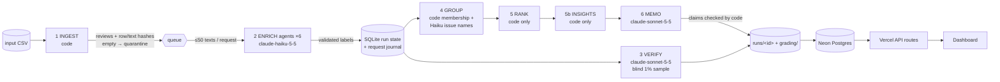

# Spotify review insights — a multi-agent large-data pipeline

Turns 97.4 MB of real Google Play reviews of Spotify (660,622 rows, May 2022 – Nov 2023) into an inspectable product
recommendation: **where should next quarter's effort go — access, usability, playback, or billing/support?**

| | |
|---|---|
| **Live dashboard** | **https://spotify-review-insights-dun.vercel.app** — public, no login. Next.js on Vercel; its API routes read the processed data from a Neon Postgres database. |
| **Decision memo** | [`runs/final-150k/memo.md`](runs/final-150k/memo.md) (claims in [`claims.csv`](runs/final-150k/claims.csv)) |
| **Grading export** | [`grading/`](grading/) — contract files (`run.json` declares the 150k subset); self-check output in [`evals/self_check_final.json`](evals/self_check_final.json) |
| **Cost calculator** | [`cost/`](cost/) — offline replay `python -m cost.calculator`; report [`cost/report.md`](cost/report.md) |
| **Interruption / resume recording** | [Google Drive video](https://drive.google.com/file/d/1fKObwhdt5w98f80MowDUcLDdwNy4i_lI/view?usp=sharing) (run `final-100k`) + [`checkpoint_before.json`](grading/checkpoint_before.json) / [`checkpoint_after.json`](grading/checkpoint_after.json) |
| **Dataset** | Course ZIP ([Google Drive](https://drive.google.com/file/d/1P0rUoAS_wVjp3BYKqXMEyD4u0uJP1Bvf/view)); source BwandoWando, *3.4 Million Spotify Google Store Reviews* v2 (Kaggle, CC0). `spotify_reviews_18months.csv` SHA-256 `1fc85de68a304dd8978b537cfa58793d5f41cbaf417fa32cb53899f83a2fcef6` (97,400,616 bytes). Not committed. |

> **Scope (declared).** The **entire 660,622-row file is ingested, profiled and hash-checked**. Classification covers
> a declared, deterministic **150,013-row analysis subset** (150,000 nonempty reviews + all 13 empty texts) — 1.5× the
> assignment's "at least 100,000" option. It was built in two nested steps: a 100,013-row subset (run `final-100k`,
> which contains the recorded interruption/resume) extended by the next 50,000 hash-ordered reviews (run `final-150k`,
> which reuses every 100k result through the exact-text cache and labels only the new reviews). The remaining ~510k
> nonempty reviews are profiled but **not classified** (a local-model "phase 2" is planned), so the coverage point is
> partial by design. Numbers below are from `final-150k` unless labelled otherwise.

__RESULTS__

---

## Rubric → evidence map

| Rubric item | Evidence |
|---|---|
| **D1** Accessible code/setup and artifacts | [Setup](#setup), [`requirements.txt`](requirements.txt), [`.env.example`](.env.example), commands below; all outputs committed under `runs/`, `grading/`, `cost/`, `evals/` |
| **D2** Architecture, shared schema, provenance | [Architecture](#architecture), [`prompts/labels.md`](prompts/labels.md), [`pipeline/schema.py`](pipeline/schema.py), per-run [`manifest.json`](runs/final-150k/manifest.json) (input SHA-256, code commit, prompt hashes, model IDs/settings, label_config), row hashes in every record |
| **D3** Memo numbers linked to calculations & sources | [`memo.md`](runs/final-150k/memo.md) cites claim IDs → [`claims.csv`](runs/final-150k/claims.csv) → [`ranking.csv`](runs/final-150k/ranking.csv) → [`membership.csv`](runs/final-150k/membership.csv) → [`enriched.jsonl.gz`](runs/final-150k/enriched.jsonl.gz); code validation in [`pipeline/stages/memo.py`](pipeline/stages/memo.py); [traced example](#one-review-traced-end-to-end) |
| **D4** Coherent recommendation, alternatives, limitations | [Decision memo](#decision-memo), dashboard recommendation panel, [Limitations](#limitations) |
| **T1** 50 human labels, per-field comparison, error analysis | [`evals/golden/`](evals/golden/): [`golden_50_labeled.csv`](evals/golden/golden_50_labeled.csv), [`per_case.csv`](evals/golden/per_case.csv), [`results.json`](evals/golden/results.json), confusion tables, [`error_analysis.md`](evals/golden/error_analysis.md) |
| **T2** Independent verification, planted-error and injection tests | [`runs/final-150k/verify/`](runs/final-150k/verify/) (blind Sonnet re-label + disagreement report + planted-error test), [`evals/injection/injection_results.json`](evals/injection/injection_results.json), human spot-check [`evals/spotcheck/dev-500/`](evals/spotcheck/dev-500/) |
| **T3** Real cold/warm pilot, calculator, retry/spend/recovery controls | [`cost/report.md`](cost/report.md), [`cost/`](cost/) evidence files, [`tests/test_calculator.py`](tests/test_calculator.py), [`tests/test_recovery.py`](tests/test_recovery.py), [controls](#controls-retries-spend-recovery), recording |
| **W1** Full ingestion, coverage, classification | [`runs/ingestion/ingestion_report.json`](runs/ingestion/ingestion_report.json), [`grading/ingestion.json`](grading/ingestion.json) (checker-identical), 150k coverage in self-check |
| **W2** Runnable staged program, bounded calls, saved handoffs, resume | `python -m pipeline run --input <csv>`; ≤50 reviews/request; per-stage files in `runs/<id>/`; checkpoints + video; crash/outage tests |
| **W3** Reproducible ranking + deployed dashboard/backend/DB with grounded AI recommendation | `python -m pipeline rank --run-id final-150k` (byte-identical), live dashboard, [`db/`](db/), [`dashboard/`](dashboard/) |

---

## Architecture



| # | Stage | Owner | Input → output (saved handoff) | Failure / stop behaviour |
|---|---|---|---|---|
| 1 | Ingest | code | CSV → `reviews` table (exact strings, `source_sha256`, `text_sha`), `ingest.json`; empty text → `quarantined/empty_review_text` | malformed CSV or duplicate ID aborts |
| 2 | Enrich | **ENRICHER** agents (Haiku 5.5, thinking off, effort low, `enrich_v1`) | ≤50 `{review_id, review_text}` per request → `topic, subtopic, intent, sentiment, severity, entities, evidence_quote, needs_review` (`enriched.jsonl.gz`) | code validates every ID/field/quote; invalid items retried once → capped Sonnet fallback (≤2%) → quarantine with reason; transient errors back off; outage pauses dispatch; spend cap / Ctrl-C finish in-flight work and stop |
| 3 | Verify | **VERIFIER** (Sonnet 5.5, separate prompt `verify_v1`) | declared random 1% sample, text only → `verify/verifier_predictions.jsonl`; code → `verifier_report.json`, `disagreements.jsonl`, `planted_error_test.json` | resumable per ID; failures listed in the report |
| 4 | Group | code + **GROUPER** (Haiku 5.5, `group_v1`) | complaint/cancellation records → `membership.csv` (`issue_id = topic.subtopic`, one issue per review); ≤8 quotes per issue → titles/descriptions/misfit flags (`issues.json`) | model cannot change membership; invented IDs rejected; cached by evidence-pack hash |
| 5 | Rank | code | records + membership → `ranking.csv` | deterministic; regenerated offline |
| 5b | Insights | code | records → `insights.json`: monthly series, anomalies vs expected range with drivers, recurring/chronic issues, alternative rankings, comparable periods, app-version and severity breakdowns, curated external events ([`data/events.json`](data/events.json)) | deterministic; declared thresholds |
| 6 | Memo | **MEMO WRITER** (Sonnet 5.5, `memo_v2`) + code validator | ranking top 15, area/topic/month aggregates, compact insights, bounded evidence pack (prompt `memo_v2`) → `memo.json`, `memo.md`, `claims.csv` | every claim value, cited ID and prose number is checked; one corrective retry, then the stage fails loudly; cached by input hash |

**Where code decides vs. where a model judges.** Models only read language: label a review, name an issue from
quotes, write prose from saved numbers. Code owns record accounting (which IDs exist, what is sent, what is
accepted), the exact-text cache, all arithmetic, ranking order, budgets and the next step. The orchestrator
(`pipeline/cli.py`) runs a fixed stage sequence; inside enrichment it dispatches batches to a pool of named agents
that share one spend ledger and rate limiter.

**Caching and provenance.** Exact-duplicate texts are labelled once; every other row with the same text is a
separate output record with `cache_source_id` pointing directly at the original (never chains). A persistent
cross-run cache (`state/result_cache.sqlite`, keyed by text hash + `label_config`) reused the pilot/500/10k/golden
results in the final run, importing the original call record so each reused result keeps model-call evidence. Any
change of model, effort, prompt, schema or taxonomy changes `label_config` and invalidates both caches.

**Why each model call exists.** Topic/intent/severity need language judgment (Haiku is the cheapest model that held
quality on the 500/10k checks). Verification uses a *different, stronger* model so agreement is not one model
agreeing with itself. Issue names need language but membership does not. The memo needs prose but not arithmetic.

---

## Setup

Python 3.12+ (tested 3.14.7), Node 20+ (dashboard). No key is needed for anything except paid runs.

```bash
python3 -m venv .venv && .venv/bin/pip install -r requirements.txt
cp .env.example .env     # only for paid runs / DB loading: ANTHROPIC_API_KEY, DATABASE_URL
# place the course dataset folder "Final Assignment - Spotify Reviews Dataset/" in the project root
```

### Offline commands (no API key, no cost)

```bash
.venv/bin/python -m pipeline profile                                    # full-file profile (660,622 rows)
.venv/bin/python -m pipeline rank --run-id final-150k        # deterministic re-rank from saved records + membership
.venv/bin/python -m cost.calculator                                     # cost/runtime replay -> cost/report.md
.venv/bin/python -m pytest -q tests                                     # calculator + crash/outage/resume tests (fake model)
.venv/bin/python evals/eval_golden.py --run-id golden-eval              # golden-50 scoring
python3 check_submission.py check --reference local-reference.json --submission grading --out self-check.json
```

### Paid commands (explicit)

```bash
.venv/bin/python -m pipeline run --input <any.csv> --run-id <id> --workers 6 --spend-cap 15   # all six stages
scripts/run_detached.sh <id> <any.csv> --workers 6     # same, survives closing the terminal; keeps the Mac awake
.venv/bin/python -m pipeline watch --run-id <id>       # live progress, ETA, spend, per-agent stats
scripts/stop_run.sh <id>                               # graceful stop (saves, writes checkpoint)
.venv/bin/python -m cost.pilot --paid                  # the 100-review cold/warm pilot
.venv/bin/python evals/run_injection_test.py --paid    # synthetic injection test (~$0.01)
```

### Database and dashboard

```bash
.venv/bin/python db/load_db.py --run-id final-150k --final   # loads saved artifacts into Postgres (db/schema.sql)
cd dashboard && npm install && npm run dev                   # local; needs DATABASE_URL in dashboard/.env.local
```

---

__DETAILS__
